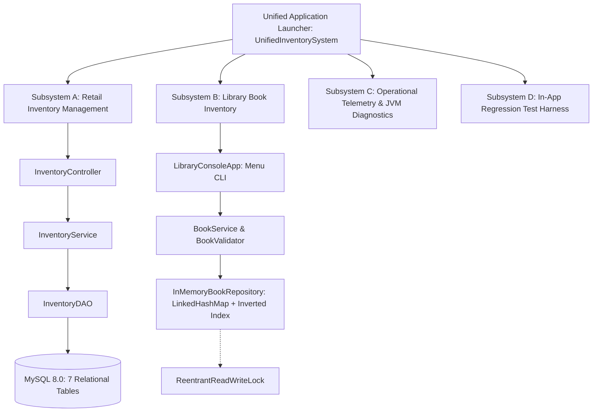

# Retail & Library Inventory Management System

A robust, enterprise-grade Java application designed to streamline inventory tracking, product cataloging, order fulfillment, and library book management. Developed as part of the 5-Week Java Application Development Internship on the Yuva Learn platform.

---

## 📌 Project Milestones Overview

| Milestone | Task Title | Focus & Core Deliverables | Status |
| :--- | :--- | :--- | :---: |
| **Week 1** | **Project Planning & Architecture Design** | Layered Architecture, Design Patterns (MVC, DAO, Singleton, Factory), 7-Table Relational MySQL DDL, and Scaffolding. | ✅ Complete |
| **Week 2** | **Core Functionality Implementation** | Library Book Inventory CLI program, Java Collections (`LinkedHashMap`), Full CRUD, Input Validation, Custom Exceptions, and Automated Tests. | ✅ Complete |
| **Week 3** | **Unit Testing & Debugging** | JUnit 5 Test Suite (34 Tests), Standalone Test Runner, 5 Intentional Debugging Case Studies & Root Cause Analysis (RCA), Code Refactoring. | ✅ Complete |
| **Week 4** | **Code Refactoring & Optimization** | Builder Pattern, Algorithmic Inverted Index Search ($O(1)$), High-Concurrency `ReentrantReadWriteLock`, Paginated Queries, Centralized `BookValidator`, 38 Tests. | ✅ Complete |
| **Week 5** | **Integration, Deployment & Documentation** | Unified Multi-Module Launcher (`UnifiedInventorySystem`), Standalone Executable JAR, Cross-Platform Deployment Scripts (PowerShell, Bash, Batch), Docker & Docker Compose Orchestration, Comprehensive Developer Handoff Manual. | ✅ Complete |

---

## 🏛️ System Architecture & Subsystem Integration (Week 5)



---

## 🚀 How to Run the Application

### 1. Run the Standalone Executable JAR (Zero Setup)
```bash
java -jar dist/retail-inventory-system-1.0.jar
```

### 2. Windows Automated Deployment & Run
* **Using PowerShell:**
  ```powershell
  powershell -ExecutionPolicy Bypass -File scripts/deploy.ps1 -RunAfterBuild
  ```
* **Using Batch:**
  ```cmd
  scripts\run.bat
  ```

### 3. Linux / macOS Automated Deployment & Run
```bash
chmod +x scripts/deploy.sh scripts/run.sh
./scripts/deploy.sh
./scripts/run.sh
```

### 4. Cloud Container Deployment (Docker & Docker Compose)
```bash
# Build and run containerized application with MySQL database
docker-compose up --build
```

---

## 🧪 Automated Testing & Verification

### Run the JUnit 5 Jupiter Suite (38 Tests)
```bash
java -jar lib/junit-platform-console-standalone-1.10.2.jar execute --class-path bin --select-class com.inventory.library.BookServiceUnitTest --details=tree
```

### Run the Standalone Test Harness (Zero Dependencies)
```bash
java -cp bin com.inventory.library.LibraryTestRunner
```

---

## 📂 Project Structure

```text
retail-inventory-management-system/
├── .gitignore
├── pom.xml                                            # Maven configuration with JUnit 5.10.2
├── README.md                                          # Master documentation across all 5 weeks
├── Dockerfile                                         # Multi-stage production container build
├── docker-compose.yml                                 # Application & MySQL service orchestration
├── database/
│   └── schema.sql                                     # 7-table MySQL DDL schema (Week 1)
├── dist/
│   ├── MANIFEST.MF                                    # Executable JAR manifest
│   └── retail-inventory-system-1.0.jar                # Production Executable Standalone JAR (43 KB)
├── docs/
│   ├── Retail_Inventory_Management_Week1_Report.docx  # Week 1 Design Document (~2,040 words)
│   ├── architecture_diagram.png                       # High-resolution architectural diagram
│   ├── Library_Book_Inventory_Week2_Report.docx       # Week 2 Implementation Document (~1,650 words)
│   ├── library-inventory-system-week2.zip             # Week 2 Commented Java source package
│   ├── Library_Inventory_Week3_Testing_and_Debugging_Report.docx # Week 3 QA Document (~1,590 words)
│   ├── library-inventory-system-week3-tests.zip       # Week 3 Source & Test package
│   ├── Library_Inventory_Week4_Refactoring_and_Optimization_Report.docx # Week 4 Document (~1,610 words)
│   ├── library-inventory-system-week4-refactored.zip  # Week 4 Refactored Source package
│   ├── Comprehensive_Integration_Deployment_and_Developer_Guide_Week5.docx # Week 5 Final Report (~1,503 words)
│   └── retail-inventory-management-system-final-week5.zip # Week 5 Final Deployment Package
├── lib/
│   └── junit-platform-console-standalone-1.10.2.jar   # Standalone JUnit 5 Console Runner
├── scripts/
│   ├── deploy.ps1                                     # PowerShell automated build & deploy
│   ├── run.bat                                        # Windows Batch execution script
│   ├── deploy.sh                                      # Linux/macOS Bash deployment script
│   ├── run.sh                                         # Linux/macOS Bash run script
│   └── package_jar.py                                 # Automated JAR packaging tool
└── src/
    ├── main/java/com/inventory/
    │   ├── UnifiedInventorySystem.java                # Master Application Launcher (Week 5)
    │   ├── controller/InventoryController.java        # Week 1 Retail Controller
    │   ├── dao/InventoryDAO.java                      # Week 1 Retail DAO
    │   ├── factory/ReportFactory.java                 # Week 1 Factory Pattern
    │   ├── model/Inventory.java & Product.java        # Week 1 Retail Models
    │   ├── service/InventoryService.java              # Week 1 Retail Service
    │   ├── util/DatabaseConnectionManager.java        # Week 1 Singleton Manager
    │   └── library/                                   # Weeks 2-4 Library Core Implementation
    │       ├── cli/LibraryConsoleApp.java             # Menu-driven CLI with Sorting & Pagination
    │       ├── exception/                             # Custom Exceptions
    │       │   ├── BookNotFoundException.java
    │       │   ├── DuplicateBookException.java
    │       │   └── InvalidBookDataException.java
    │       ├── model/Book.java                        # Encapsulated Book Entity with Builder Pattern
    │       ├── repository/                            # Collections Repository
    │       │   ├── BookRepository.java                # Repository Contract with Pagination
    │       │   └── InMemoryBookRepository.java        # ReadWriteLock & Inverted Index Storage
    │       ├── service/BookService.java               # Business Rules, Sorting & Page Delegation
    │       └── util/BookValidator.java                # Centralized DRY Domain Validator
    └── test/java/com/inventory/library/
        ├── BookServiceUnitTest.java                   # JUnit 5 Comprehensive Test Suite (38 Tests)
        └── LibraryTestRunner.java                     # Standalone Zero-Dependency Test Runner (20 Tests)
```

---

## 📄 Deliverables Summary Across All Weeks

| Milestone | Report File (.docx) | Code / Packaging Archive (.zip) |
| :--- | :--- | :--- |
| **Week 1** | [`docs/Retail_Inventory_Management_Week1_Report.docx`](docs/Retail_Inventory_Management_Week1_Report.docx) | Full Scaffolding under `src/main/java/` |
| **Week 2** | [`docs/Library_Book_Inventory_Week2_Report.docx`](docs/Library_Book_Inventory_Week2_Report.docx) | [`docs/library-inventory-system-week2.zip`](docs/library-inventory-system-week2.zip) |
| **Week 3** | [`docs/Library_Inventory_Week3_Testing_and_Debugging_Report.docx`](docs/Library_Inventory_Week3_Testing_and_Debugging_Report.docx) | [`docs/library-inventory-system-week3-tests.zip`](docs/library-inventory-system-week3-tests.zip) |
| **Week 4** | [`docs/Library_Inventory_Week4_Refactoring_and_Optimization_Report.docx`](docs/Library_Inventory_Week4_Refactoring_and_Optimization_Report.docx) | [`docs/library-inventory-system-week4-refactored.zip`](docs/library-inventory-system-week4-refactored.zip) |
| **Week 5** | [`docs/Comprehensive_Integration_Deployment_and_Developer_Guide_Week5.docx`](docs/Comprehensive_Integration_Deployment_and_Developer_Guide_Week5.docx) | [`docs/retail-inventory-management-system-final-week5.zip`](docs/retail-inventory-management-system-final-week5.zip) |
