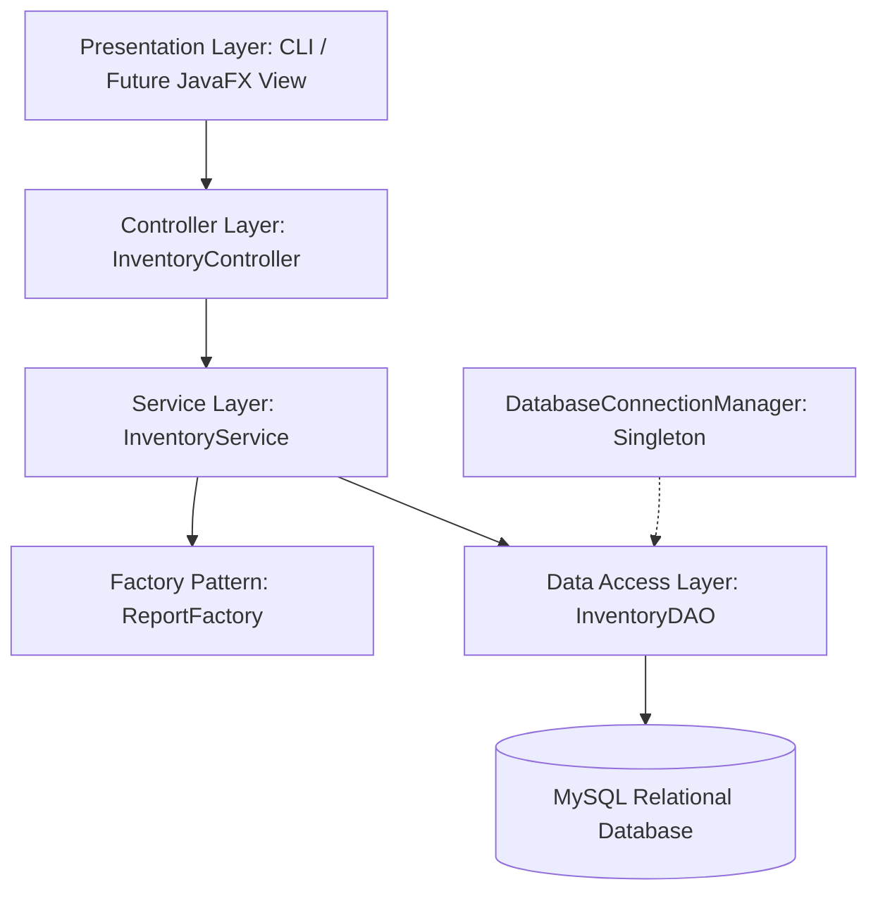
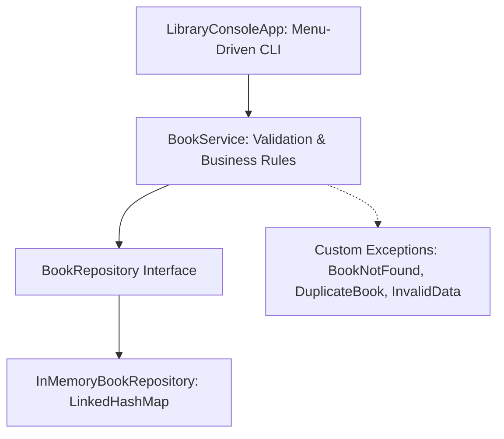

# Retail & Library Inventory Management System

A robust, enterprise-ready Java application designed to streamline inventory tracking, product cataloging, order fulfillment, and library book management. Developed as part of the Java Application Development Internship on the Yuva Learn platform.

---

## 📌 Project Milestones Overview

| Milestone | Task Title | Focus & Core Deliverables | Status |
| :--- | :--- | :--- | :---: |
| **Week 1** | **Project Planning & Architecture Design** | Layered Architecture, Design Patterns (MVC, DAO, Singleton, Factory), 7-Table Relational MySQL DDL, and Scaffolding. | ✅ Complete |
| **Week 2** | **Core Functionality Implementation** | Library Book Inventory CLI program, Java Collections (`LinkedHashMap`), Full CRUD, Input Validation, Custom Exceptions, and Automated Tests. | ✅ Complete |

---

## 🏛️ Week 1: Retail Inventory System Architecture

The Retail Inventory application adopts a **Tiered Layered Architecture** ensuring strict separation of concerns, high cohesion, and low coupling across modules:



### Architectural Layers & Patterns (Week 1)
* **Model-View-Controller (MVC):** Decouples data representations from business logic and console views.
* **Data Access Object (DAO):** Isolates persistence mechanics behind clean Java interfaces.
* **Singleton Pattern (`DatabaseConnectionManager`):** Guarantees a single, thread-safe database connection pool.
* **Factory Method Pattern (`ReportFactory`):** Dynamically instantiates report formats (`SALES`, `INVENTORY`, `PURCHASE`, `LOW_STOCK`).
* **Database Schema:** 7 normalized relational tables in [`database/schema.sql`](database/schema.sql).

---

## 📚 Week 2: Library Book Inventory System (Core Implementation)

Week 2 focuses on hands-on implementation by creating a menu-driven command-line program that manages a library's book inventory using the **Java Collections Framework**.



### Key Technical Highlights (Week 2)
1. **Book Domain Entity (`com.inventory.library.model.Book`):**
   * Properties: `isbn` (unique ID), `title`, `author`, `publicationYear`.
   * Complete encapsulation with getters/setters, formatted table stringify, and `equals`/`hashCode` based on ISBN.
2. **Optimal Java Collection Strategy:**
   * Utilizes **`LinkedHashMap<String, Book>`** for in-memory storage.
   * Delivers **$O(1)$ constant-time lookup, update, and deletion** by ISBN while **preserving insertion order** for catalog listings.
3. **Full CRUD & Search Capabilities:**
   * **Create:** Adds new books with uniqueness validation.
   * **Read:** Lists all books in formatted ASCII tables; searches by exact ISBN in $O(1)$; searches by title/author keywords using Java Streams.
   * **Update:** Edits book metadata while preserving current values on empty inputs.
   * **Delete:** Safely removes books after user confirmation (`y/N`).
4. **Robust Domain Validation & Custom Exception Hierarchy:**
   * `BookNotFoundException`: Thrown when ISBN cannot be located.
   * `DuplicateBookException`: Thrown when attempting to register an existing ISBN.
   * `InvalidBookDataException`: Guards against blank titles/authors, malformed ISBNs, and out-of-range publication years.
5. **Interactive Console Menu:**
   * Non-crashing line-based input reading (`scanner.nextLine()`).
   * Preloaded with classic software engineering literature for immediate testing.

---

## 📂 Project Structure

```text
retail-inventory-management-system/
├── .gitignore
├── pom.xml                                            # Maven configuration with dependencies
├── README.md                                          # Complete project documentation
├── database/
│   └── schema.sql                                     # 7-table MySQL DDL schema (Week 1)
├── docs/
│   ├── Retail_Inventory_Management_Week1_Report.docx  # Week 1 Design Document (~2,040 words)
│   ├── architecture_diagram.png                       # High-resolution architectural diagram
│   ├── Library_Book_Inventory_Week2_Report.docx       # Week 2 Implementation Document (~1,650 words)
│   └── library-inventory-system-week2.zip             # Week 2 Commented Java source package
└── src/
    ├── main/java/com/inventory/
    │   ├── controller/InventoryController.java        # Week 1 Retail Controller
    │   ├── dao/InventoryDAO.java                      # Week 1 Retail DAO
    │   ├── factory/ReportFactory.java                 # Week 1 Factory Pattern
    │   ├── model/Inventory.java & Product.java        # Week 1 Retail Models
    │   ├── service/InventoryService.java              # Week 1 Retail Service
    │   ├── util/DatabaseConnectionManager.java        # Week 1 Singleton Manager
    │   └── library/                                   # Week 2 Library Core Implementation
    │       ├── cli/LibraryConsoleApp.java             # Menu-driven CLI Application
    │       ├── exception/                             # Custom Exceptions
    │       │   ├── BookNotFoundException.java
    │       │   ├── DuplicateBookException.java
    │       │   └── InvalidBookDataException.java
    │       ├── model/Book.java                        # Encapsulated Book Entity
    │       ├── repository/                            # Collections Repository
    │       │   ├── BookRepository.java                # Repository Contract
    │       │   └── InMemoryBookRepository.java        # LinkedHashMap Storage
    │       └── service/BookService.java               # Validation & Business Operations
    └── test/java/com/inventory/
        └── library/LibraryTestRunner.java             # Standalone 20-Test Unit Suite
```

---

## 🚀 How to Compile and Run

### Prerequisites
* **Java Development Kit (JDK):** Version 17 or higher (tested with JDK 26)

### 1. Compile the Codebase
```bash
javac -d bin src/main/java/com/inventory/**/*.java src/test/java/com/inventory/**/*.java
```

### 2. Run the Week 2 Library CLI Application
```bash
java -cp bin com.inventory.library.cli.LibraryConsoleApp
```

### 3. Run the Automated Unit Test Suite
```bash
java -cp bin com.inventory.library.LibraryTestRunner
```

#### Test Results Summary:
```text
==========================================================
 RUNNING AUTOMATED UNIT TESTS FOR LIBRARY INVENTORY SYSTEM
==========================================================
  PASS: Create Book - ISBN matches
  PASS: Create Book - Total count is 1
  PASS: Duplicate ISBN throws DuplicateBookException
  PASS: Validation - Blank title rejected
  PASS: Validation - Future year 3000 rejected
  PASS: Validation - Malformed ISBN rejected
  PASS: Find Book by ISBN - Title matches
  PASS: Find non-existent ISBN throws BookNotFoundException
  PASS: List all books - Size is 3
  PASS: List all books - First is Book 1
  PASS: List all books - Last is Book 3
  PASS: Search 'java' returns 2 books
  PASS: Search 'Martin' returns 1 book
  PASS: Update Book - Title updated
  PASS: Update Book - Author updated
  PASS: Update Book - Year updated
  PASS: Count before delete
  PASS: Deleted book ISBN
  PASS: Count after delete
  PASS: Delete non-existent ISBN throws BookNotFoundException
----------------------------------------------------------
Test Results: 20 Passed | 0 Failed
==========================================================
```

---

## 📄 Deliverables Summary for Evaluation

### Week 1 Deliverables
* **Report File:** [`docs/Retail_Inventory_Management_Week1_Report.docx`](docs/Retail_Inventory_Management_Week1_Report.docx)
* **High-Level Diagram:** [`docs/architecture_diagram.png`](docs/architecture_diagram.png)
* **Code Scaffolding:** `src/main/java/com/inventory/`

### Week 2 Deliverables
* **Report File:** [`docs/Library_Book_Inventory_Week2_Report.docx`](docs/Library_Book_Inventory_Week2_Report.docx)
* **Source Archive:** [`docs/library-inventory-system-week2.zip`](docs/library-inventory-system-week2.zip)
* **Core Application:** [`src/main/java/com/inventory/library/cli/LibraryConsoleApp.java`](src/main/java/com/inventory/library/cli/LibraryConsoleApp.java)
* **Automated Tests:** [`src/test/java/com/inventory/library/LibraryTestRunner.java`](src/test/java/com/inventory/library/LibraryTestRunner.java)
