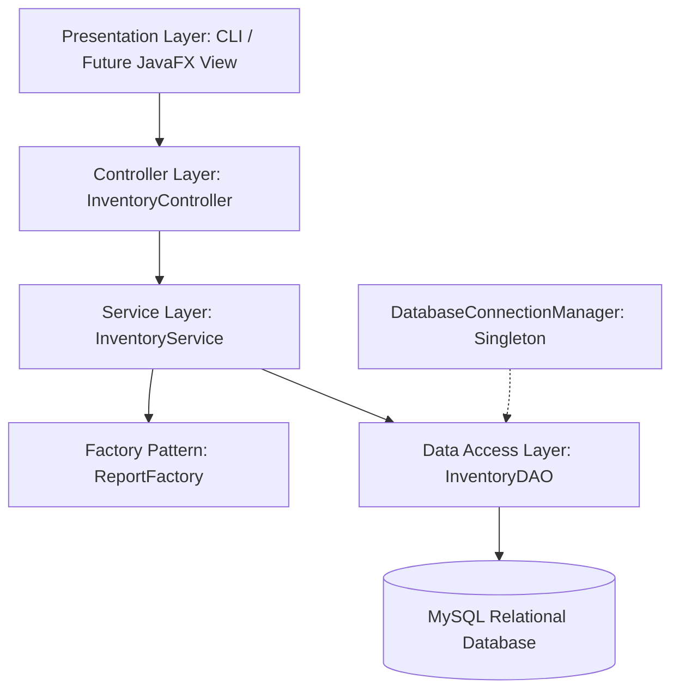
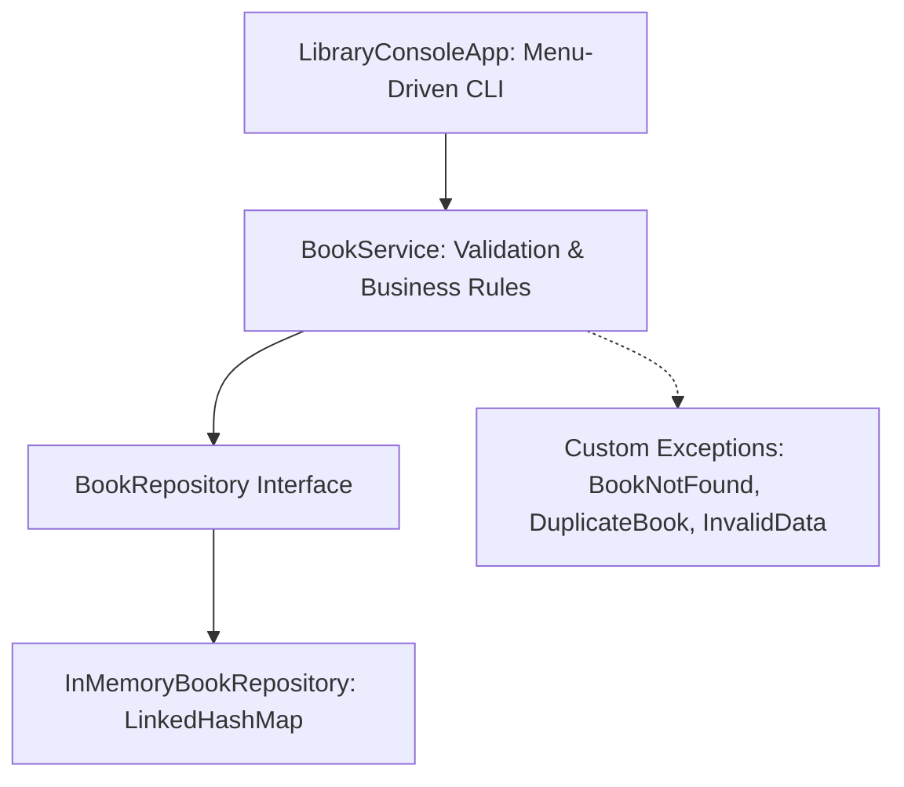

# Retail & Library Inventory Management System

A robust, enterprise-ready Java application designed to streamline inventory tracking, product cataloging, order fulfillment, and library book management. Developed as part of the Java Application Development Internship on the Yuva Learn platform.

---

## 📌 Project Milestones Overview

| Milestone | Task Title | Focus & Core Deliverables | Status |
| :--- | :--- | :--- | :---: |
| **Week 1** | **Project Planning & Architecture Design** | Layered Architecture, Design Patterns (MVC, DAO, Singleton, Factory), 7-Table Relational MySQL DDL, and Scaffolding. | ✅ Complete |
| **Week 2** | **Core Functionality Implementation** | Library Book Inventory CLI program, Java Collections (`LinkedHashMap`), Full CRUD, Input Validation, Custom Exceptions, and Automated Tests. | ✅ Complete |
| **Week 3** | **Unit Testing & Debugging** | JUnit 5 Test Suite (34 Tests), Standalone Test Runner, 5 Intentional Debugging Case Studies & Root Cause Analysis (RCA), Code Refactoring. | ✅ Complete |

---

## 🏛️ Week 1: Retail Inventory System Architecture

The Retail Inventory application adopts a **Tiered Layered Architecture** ensuring strict separation of concerns, high cohesion, and low coupling across modules:



### Architectural Layers & Patterns (Week 1)
* **Model-View-Controller (MVC):** Decouples data representations from business logic and console views.
* **Data Access Object (DAO):** Isolates persistence mechanics behind clean Java interfaces.
* **Singleton Pattern (`DatabaseConnectionManager`):** Guarantees a single, thread-safe database connection pool.
* **Factory Method Pattern (`ReportFactory`):** Dynamically instantiates report formats (`SALES`, `INVENTORY`, `PURCHASE`, `LOW_STOCK`).
* **Database Schema:** 7 normalized relational tables in [`database/schema.sql`](database/schema.sql).

---

## 📚 Week 2: Library Book Inventory System (Core Implementation)

Week 2 focused on hands-on implementation by creating a menu-driven command-line program that manages a library's book inventory using the **Java Collections Framework**.



### Key Technical Highlights (Week 2)
1. **Book Domain Entity (`com.inventory.library.model.Book`):**
   * Properties: `isbn` (unique ID), `title`, `author`, `publicationYear`.
   * Complete encapsulation with getters/setters, formatted table stringify, and `equals`/`hashCode` based on ISBN.
2. **Optimal Java Collection Strategy:**
   * Utilizes **`LinkedHashMap<String, Book>`** for in-memory storage.
   * Delivers **$O(1)$ constant-time lookup, update, and deletion** by ISBN while **preserving insertion order** for catalog listings.
3. **Full CRUD & Search Capabilities:**
   * **Create:** Adds new books with uniqueness validation.
   * **Read:** Lists all books in formatted ASCII tables; searches by exact ISBN in $O(1)$; searches by title/author keywords using Java Streams.
   * **Update:** Edits book metadata while preserving current values on empty inputs.
   * **Delete:** Safely removes books after user confirmation (`y/N`).
4. **Robust Domain Validation & Custom Exception Hierarchy:**
   * `BookNotFoundException`: Thrown when ISBN cannot be located.
   * `DuplicateBookException`: Thrown when attempting to register an existing ISBN.
   * `InvalidBookDataException`: Guards against blank titles/authors, malformed ISBNs, and out-of-range publication years.

---

## 🧪 Week 3: Unit Testing and Systematic Debugging

Week 3 focuses on software reliability, rigorous unit testing using **JUnit 5**, boundary value analysis, and intentional bug reproduction and resolution.

### 1. Testing Framework Architecture
* **JUnit 5 Jupiter Test Suite (`BookServiceUnitTest.java`):**
  * Employs `@Test`, `@BeforeEach`, `@DisplayName`, `@Nested`, `@ParameterizedTest`, `@ValueSource`.
  * Isolates test state before each run with clean repository instances.
  * 34 test cases covering positive flows, boundary conditions, custom exceptions, and regression paths.
* **Standalone Console Test Runner (`LibraryTestRunner.java`):**
  * Zero-dependency test harness runnable via raw `javac`/`java`.

### 2. Intentional Bugs & Root Cause Analysis (RCA) Case Studies

| Bug # | Defect Title & Symptom | Root Cause | Targeted Fix & Refactoring |
| :---: | :--- | :--- | :--- |
| **Bug 1** | **Inconsistent ISBN Hyphen Normalization**<br>Adding `9780134685991` permitted duplicate of `978-0134685991`. | Raw string stored without canonical formatting. | Centralized `normalizeIsbn()` stripping spaces/hyphens and converting to uppercase before hashing. |
| **Bug 2** | **Scanner Newline Skip in Console CLI**<br>Entering numeric year caused next input prompt to be skipped. | `Scanner.nextInt()` left trailing newline (`\r\n`) in stream buffer. | Refactored CLI to line-based reading (`scanner.nextLine().trim()`) with safe integer parsing helper. |
| **Bug 3** | **False Rejection of Advance Publisher Releases**<br>Legitimate upcoming editions (current year + 1) thrown as invalid. | Upper year boundary check strictly evaluated `<= currentYear`. | Adjusted boundary to `Year.now().getValue() + 1` accommodating publisher advance release cycles. |
| **Bug 4** | **Case-Sensitive Substring Matching**<br>Searching "java" returned 0 matches for "Effective Java". | `String.contains()` performs case-sensitive matching by default. | Stream filter converted both target and query strings to lower case before comparison. |
| **Bug 5** | **Shallow Reference Leak in Collections**<br>`findAll()` returned mutable collection references allowing external alteration. | Missing defensive copying in repository accessor. | Returned defensive ArrayList copies (`new ArrayList<>(storage.values())`) preventing external mutation leaks. |

---

## 📂 Project Structure

```text
retail-inventory-management-system/
├── .gitignore
├── pom.xml                                            # Maven configuration with JUnit 5.10.2
├── README.md                                          # Complete project documentation
├── database/
│   └── schema.sql                                     # 7-table MySQL DDL schema (Week 1)
├── docs/
│   ├── Retail_Inventory_Management_Week1_Report.docx  # Week 1 Design Document (~2,040 words)
│   ├── architecture_diagram.png                       # High-resolution architectural diagram
│   ├── Library_Book_Inventory_Week2_Report.docx       # Week 2 Implementation Document (~1,650 words)
│   ├── library-inventory-system-week2.zip             # Week 2 Commented Java source package
│   ├── Library_Inventory_Week3_Testing_and_Debugging_Report.docx # Week 3 QA Document (~1,590 words)
│   └── library-inventory-system-week3-tests.zip       # Week 3 Complete Source & Test package
├── lib/
│   └── junit-platform-console-standalone-1.10.2.jar   # Standalone JUnit 5 Console Runner
└── src/
    ├── main/java/com/inventory/
    │   ├── controller/InventoryController.java        # Week 1 Retail Controller
    │   ├── dao/InventoryDAO.java                      # Week 1 Retail DAO
    │   ├── factory/ReportFactory.java                 # Week 1 Factory Pattern
    │   ├── model/Inventory.java & Product.java        # Week 1 Retail Models
    │   ├── service/InventoryService.java              # Week 1 Retail Service
    │   ├── util/DatabaseConnectionManager.java        # Week 1 Singleton Manager
    │   └── library/                                   # Week 2-3 Library Core Implementation
    │       ├── cli/LibraryConsoleApp.java             # Menu-driven CLI Application
    │       ├── exception/                             # Custom Exceptions
    │       │   ├── BookNotFoundException.java
    │       │   ├── DuplicateBookException.java
    │       │   └── InvalidBookDataException.java
    │       ├── model/Book.java                        # Encapsulated Book Entity
    │       ├── repository/                            # Collections Repository
    │       │   ├── BookRepository.java                # Repository Contract
    │       │   └── InMemoryBookRepository.java        # LinkedHashMap Storage
    │       └── service/BookService.java               # Validation & Business Operations
    └── test/java/com/inventory/library/
        ├── BookServiceUnitTest.java                   # JUnit 5 Comprehensive Test Suite (34 Tests)
        └── LibraryTestRunner.java                     # Standalone Zero-Dependency Test Runner (20 Tests)
```

---

## 🚀 How to Compile and Run

### Prerequisites
* **Java Development Kit (JDK):** Version 17 or higher (tested with JDK 26)

### 1. Compile Source and Test Codebases
```bash
javac -cp "lib/*;bin" -d bin src/main/java/com/inventory/**/*.java src/test/java/com/inventory/**/*.java
```

### 2. Run the JUnit 5 Jupiter Test Suite
```bash
java -jar lib/junit-platform-console-standalone-1.10.2.jar --class-path bin --select-class com.inventory.library.BookServiceUnitTest --details=tree
```

#### JUnit 5 Execution Summary:
```text
Test run finished after 215 ms
[        13 containers found      ]
[        13 containers started    ]
[        13 containers successful ]
[        34 tests found           ]
[        34 tests started         ]
[        34 tests successful      ]
[         0 tests failed          ]
```

### 3. Run the Standalone Test Runner
```bash
java -cp bin com.inventory.library.LibraryTestRunner
```

### 4. Run the Interactive CLI Application
```bash
java -cp bin com.inventory.library.cli.LibraryConsoleApp
```

---

## 📄 Deliverables Summary for Evaluation

### Week 1 Deliverables
* **Report File:** [`docs/Retail_Inventory_Management_Week1_Report.docx`](docs/Retail_Inventory_Management_Week1_Report.docx)
* **High-Level Diagram:** [`docs/architecture_diagram.png`](docs/architecture_diagram.png)
* **Code Scaffolding:** `src/main/java/com/inventory/`

### Week 2 Deliverables
* **Report File:** [`docs/Library_Book_Inventory_Week2_Report.docx`](docs/Library_Book_Inventory_Week2_Report.docx)
* **Source Archive:** [`docs/library-inventory-system-week2.zip`](docs/library-inventory-system-week2.zip)
* **Core Application:** [`src/main/java/com/inventory/library/cli/LibraryConsoleApp.java`](src/main/java/com/inventory/library/cli/LibraryConsoleApp.java)

### Week 3 Deliverables
* **Report File:** [`docs/Library_Inventory_Week3_Testing_and_Debugging_Report.docx`](docs/Library_Inventory_Week3_Testing_and_Debugging_Report.docx)
* **Test Package Archive:** [`docs/library-inventory-system-week3-tests.zip`](docs/library-inventory-system-week3-tests.zip)
* **JUnit 5 Test Suite:** [`src/test/java/com/inventory/library/BookServiceUnitTest.java`](src/test/java/com/inventory/library/BookServiceUnitTest.java)
* **Debugging Case Studies:** Documented in Week 3 Report and README
