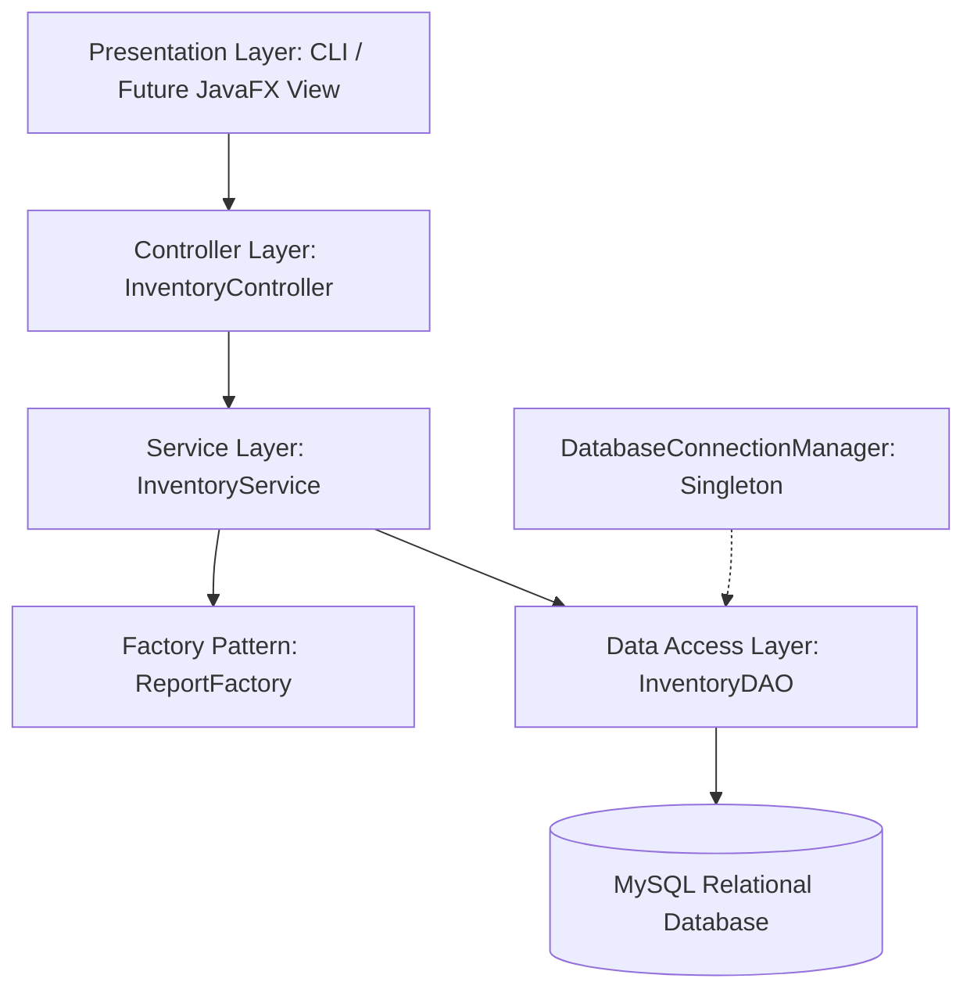

# Retail Inventory Management System

A robust, enterprise-ready Java application designed for small-to-medium retail businesses to streamline inventory tracking, product cataloging, order fulfillment, and automated supplier reporting.

---

## 📌 Project Overview

Traditional retail operations frequently struggle with manual stock reconciliation, inventory discrepancies, and disconnected order logging. The **Retail Inventory Management System** addresses these operational bottlenecks by providing a centralized, layered architecture built on core software engineering principles and object-oriented design patterns in Java.

This repository serves as the official project repository and includes the complete **Week 1: Project Planning and Architecture Design** deliverables, architectural diagrams, relational schema DDL, and Java code scaffolding.

---

## 🏛️ System Architecture

The application adopts a **Tiered Layered Architecture** ensuring strict separation of concerns, high cohesion, and low coupling across modules:



### Architectural Layers
1. **Presentation Layer:** Captures user actions and handles console input/output (extensible to JavaFX/GUI in later phases).
2. **Controller Layer (`com.inventory.controller`):** Intercepts UI requests, coordinates command flows, and delegates actions to the service layer.
3. **Service / Business Logic Layer (`com.inventory.service`):** Enforces core business validation rules (stock availability checks, order threshold validations, pricing constraints).
4. **Data Access Object (DAO) Layer (`com.inventory.dao`):** Decouples application logic from database persistence, abstracting SQL CRUD queries behind clean Java interfaces.
5. **Persistence Layer (MySQL):** Relational storage maintaining transactional consistency and referential integrity.

---

## 🎨 Software Design Patterns

| Pattern | Implementation | Purpose & Architectural Rationale |
| :--- | :--- | :--- |
| **Model-View-Controller (MVC)** | `controller/`, `model/`, CLI view | Decouples business models from user interactions and rendering logic. |
| **Data Access Object (DAO)** | `dao/InventoryDAO.java` | Isolates SQL and persistence mechanisms from service layer business rules. |
| **Singleton Pattern** | `util/DatabaseConnectionManager.java` | Ensures a single, thread-safe database connection pool/instance throughout the app lifecycle. |
| **Factory Method Pattern** | `factory/ReportFactory.java` | Decouples report type instantiation (`SALES`, `INVENTORY`, `PURCHASE`, `LOW_STOCK`) from consumer modules. |

---

## 🗄️ Relational Database Schema

The database schema is fully defined in [`database/schema.sql`](database/schema.sql) and consists of 7 normalized relational tables:

* **`users`**: Administrative and operational accounts with role-based access.
* **`categories`**: Product classifications.
* **`suppliers`**: Vendor contacts, procurement sources, and communication details.
* **`products`**: Item master catalog with foreign keys to categories and suppliers.
* **`inventory`**: Real-time stock levels, low-stock reorder thresholds, and update timestamps.
* **`customers`**: Buyer records and contact information.
* **`orders` & `order_items`**: Transactional sales records linked to inventory.

---

## 📂 Project Structure

```text
retail-inventory-management-system/
├── .gitignore
├── pom.xml
├── README.md
├── database/
│   └── schema.sql                          # MySQL DDL schema and tables
├── docs/
│   ├── Retail_Inventory_Management_Week1_Report.docx  # Comprehensive Week 1 Design Document
│   └── architecture_diagram.png            # High-resolution architectural diagram
└── src/
    └── main/
        └── java/
            └── com/
                └── inventory/
                    ├── controller/
                    │   └── InventoryController.java
                    ├── dao/
                    │   └── InventoryDAO.java
                    ├── factory/
                    │   └── ReportFactory.java
                    ├── model/
                    │   ├── Inventory.java
                    │   └── Product.java
                    ├── service/
                    │   └── InventoryService.java
                    └── util/
                        └── DatabaseConnectionManager.java
```

---

## 🚀 Getting Started

### Prerequisites
* **Java Development Kit (JDK):** Version 17 or higher (tested with JDK 26)
* **Build Tool:** Apache Maven 3.8+ (optional for CLI build)
* **Database:** MySQL 8.0+

### Compiling the Codebase

#### Using Maven:
```bash
mvn clean compile
```

#### Using `javac`:
```bash
javac -d bin src/main/java/com/inventory/**/*.java
```

---

## 📄 Week 1 Submission Deliverables
* **Report File:** [`docs/Retail_Inventory_Management_Week1_Report.docx`](docs/Retail_Inventory_Management_Week1_Report.docx)
* **High-Level Diagram:** [`docs/architecture_diagram.png`](docs/architecture_diagram.png)
* **Code Scaffolding & Interfaces:** Full package scaffold under `src/main/java/com/inventory`
